<p align="center">
  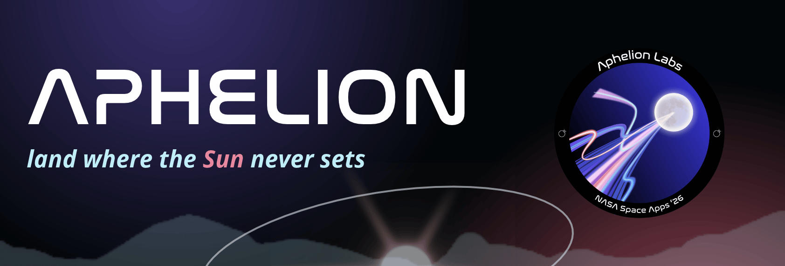
</p>

<p align="center">
  <a href="https://starvulkan.github.io/Aphelion-Lunar-Landing-Navigator/"></a>
  <a href="DATA_SOURCES.md"></a>
  <a href="VERIFY.md"></a>
</p>
<p align="center">
  
  
  
  
</p>


<br>
<p align="center"></p>

<h3 align="center"><em>At the Moon's south pole the Sun never climbs more than a couple of degrees.<br>One ridge gets light for months. The crater beside it has been dark for billions of years.<br>Aphelion shows you which is which, for any place and any day.</em></h3>

<br>

<p align="center"></p>

##  The challenge

Missions to the lunar south pole live or die by two things: **sunlight** for power and a **line of sight to Earth** for radio. Near the pole the Sun and Earth both sit almost on the horizon, so a ridge a few kilometres away can decide whether a lander is lit, cold, or cut off. Tools that can answer this already exist, but they are built for specialists and slow to use.

The challenge asked for an intuitive web app that lets **mission planners, educators and the public** compare landing sites and dates quickly, seeing where the Sun and Earth are relative to the horizon, how long power and direct-to-Earth contact last, and how that changes over a lunar day or a season.

<p align="center"></p>

##  What we built (high-level summary)

**Aphelion** runs entirely in the browser with zero server setup. Just drop in coordinates (or pick a curated site), set your dates, and the app instantly calculates:

- **Where the Sun and Earth are**, against the **real terrain horizon** of that exact spot, built from NASA's Lunar Orbiter Laser Altimeter (LOLA) data.
- **How much power and radio contact the stay gets**: sunlight %, Earth-in-view %, both at once, the longest dark spell, and the time to the next sunset or Earthset.
- **A single overall score from 0 to 100** so sites and dates can be compared at a glance.
- **How the answer changes** if the landing slips a day or two, across a calendar of landing days, and across the whole year (the south pole has seasons).

It has two modes for two audiences:

| | **Mission mode** | **Learn mode** |
|---|---|---|
| **For** | Planners, engineers, judges in a hurry | Students, teachers, the curious public |
| **Feels like** | A flight console: every number on one screen | A playful course: big type, glass cards, missions |
| **Inside** | 3D terrain with real shadows, 360° panorama, Moon globe with Earth and Sun, timeline, sky dome, slip table, season chart, comparison table, CSV export | 10 short lessons with live labs, quizzes, XP, ranks, badges, and 4 missions checked against your real scenario, in English or Spanish |
| **Levels** | **Professional** (all the data) or **Educational** (the same scenario as a friendly landing report) | |

**Why it matters:** the same few kilometres can mean months of light or permanent darkness. Making that visible in seconds helps planners screen options, and helps everyone else understand why the Moon's south pole is so hard, and so worth it.

**New here?** Press the **Tour** button (the star in the top bar) for a one-minute guided tour. A spotlight moves through every part of the app while a short card explains it, from picking a site to earning badges. First-time visitors get a small invitation to take it.

**¿Hablas español?** Switch the top bar to **ES** and Learn mode and the tour change to Spanish: all ten lessons, quizzes, labs and missions, with the same numbers and answers as the English version. It starts in Spanish automatically when your browser is set to Spanish, ready for classrooms in Honduras.

**Fun Fact!** The UI for Learn Mode and Educational Mode in Mission Mode takes inspiration from UI elements and animations from Lando Norris's official website! https://landonorris.com/

<p align="center"></p>

##  A quick tour

<table>
  <tr>
    <td width="50%">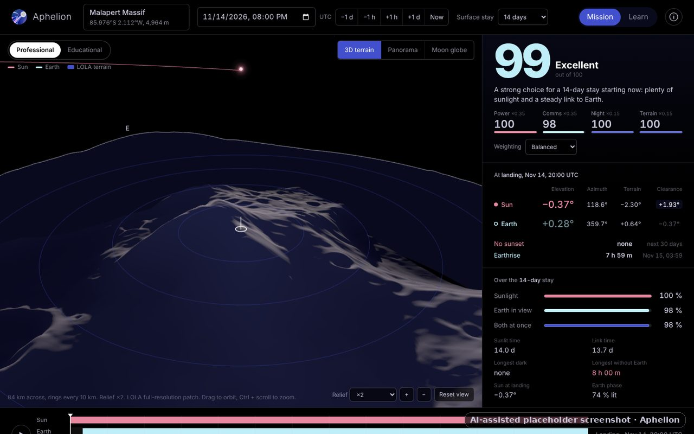<br><sub><b>Mission · Professional.</b> The view and a dense summary side by side: score, Sun and Earth elevation, azimuth and clearance above the terrain, and stay totals.</sub></td>
    <td width="50%">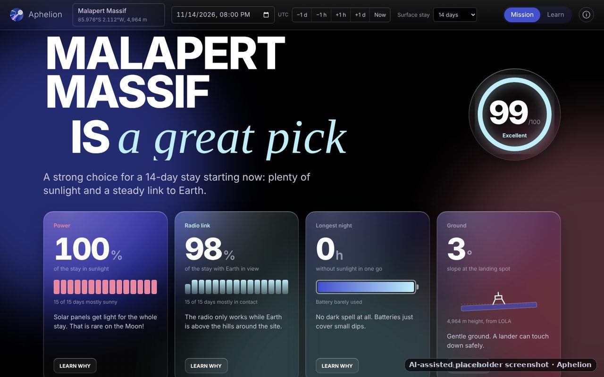<br><sub><b>Mission · Educational.</b> The same scenario as a landing report: power, radio link, longest night and ground slope, each with a picture and a "Learn why" link.</sub></td>
  </tr>
  <tr>
    <td>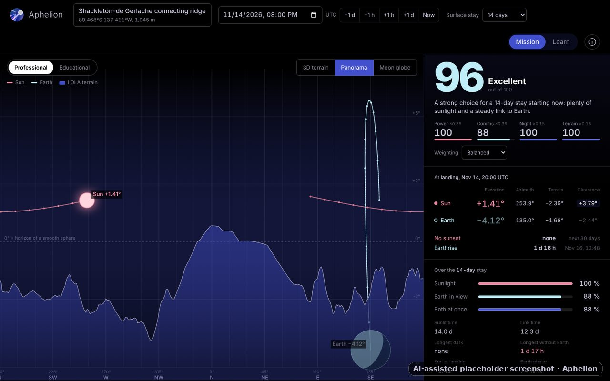<br><sub><b>Panorama.</b> The real horizon all the way round, with the Sun's and Earth's paths over the stay.</sub></td>
    <td>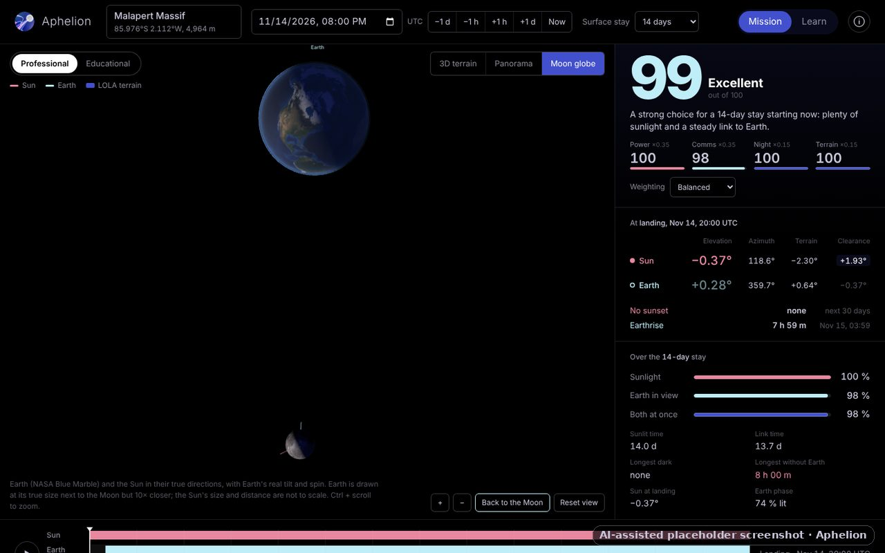<br><sub><b>Moon, Earth and Sun.</b> NASA's Moon model, Earth from NASA Blue Marble with its real tilt and spin, the Sun from measured physics.</sub></td>
  </tr>
  <tr>
    <td>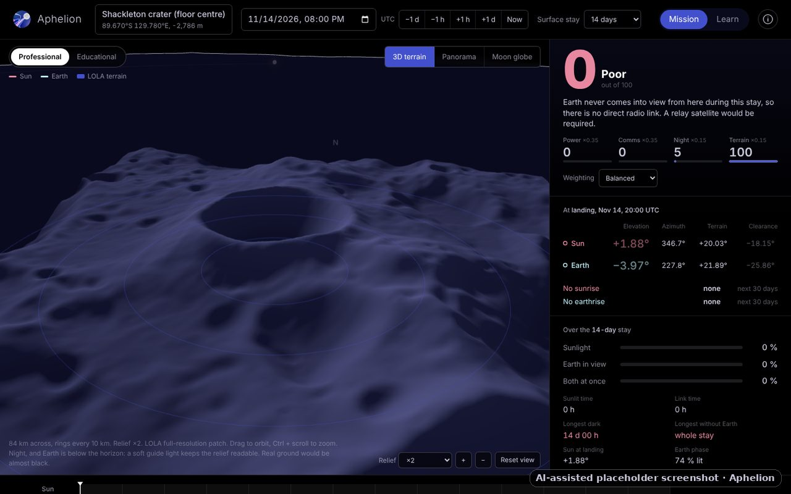<br><sub><b>3D terrain at night.</b> Earthshine plus a soft guide light keep craters readable when the Sun is gone.</sub></td>
    <td>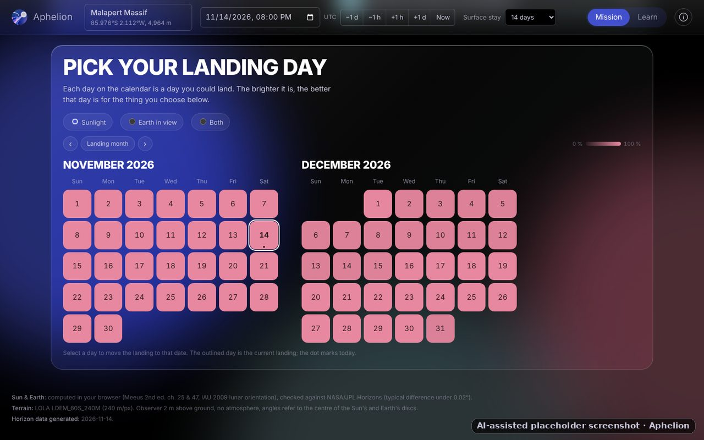<br><sub><b>Landing calendar.</b> Every day you could land, shaded by sunlight, Earth contact or both.</sub></td>
  </tr>
  <tr>
    <td>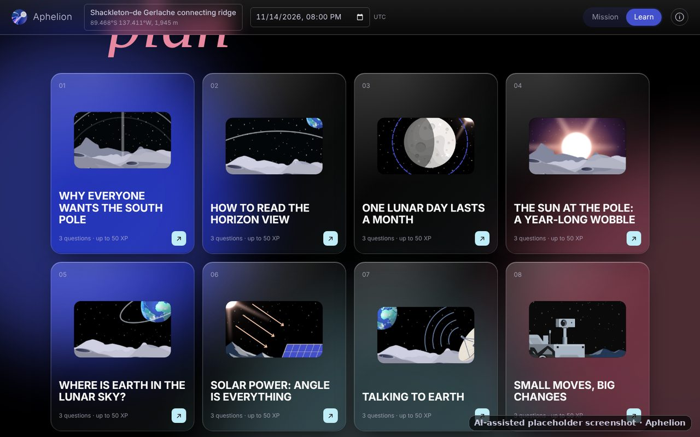<br><sub><b>Learn mode.</b> A course in ten short lessons, each with its own illustration by the team.</sub></td>
    <td>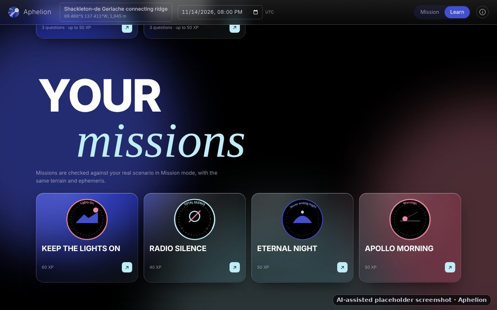<br><sub><b>Missions and badges.</b> Four missions checked against your real scenario, each with a badge designed by the team.</sub></td>
  </tr>
  <tr>
    <td>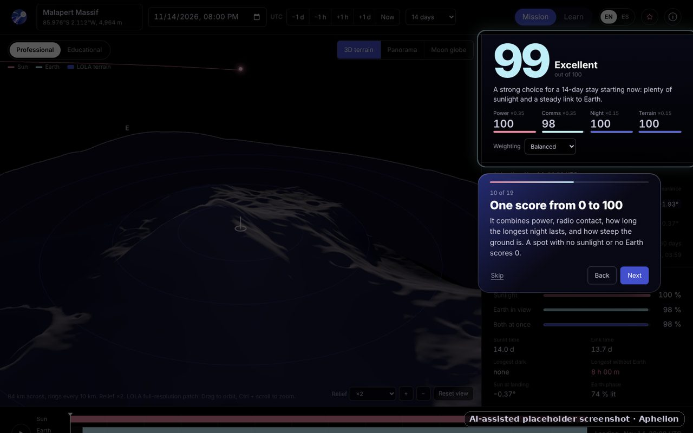<br><sub><b>Guided tour.</b> A one-minute walk through the whole app, one spotlight at a time.</sub></td>
    <td>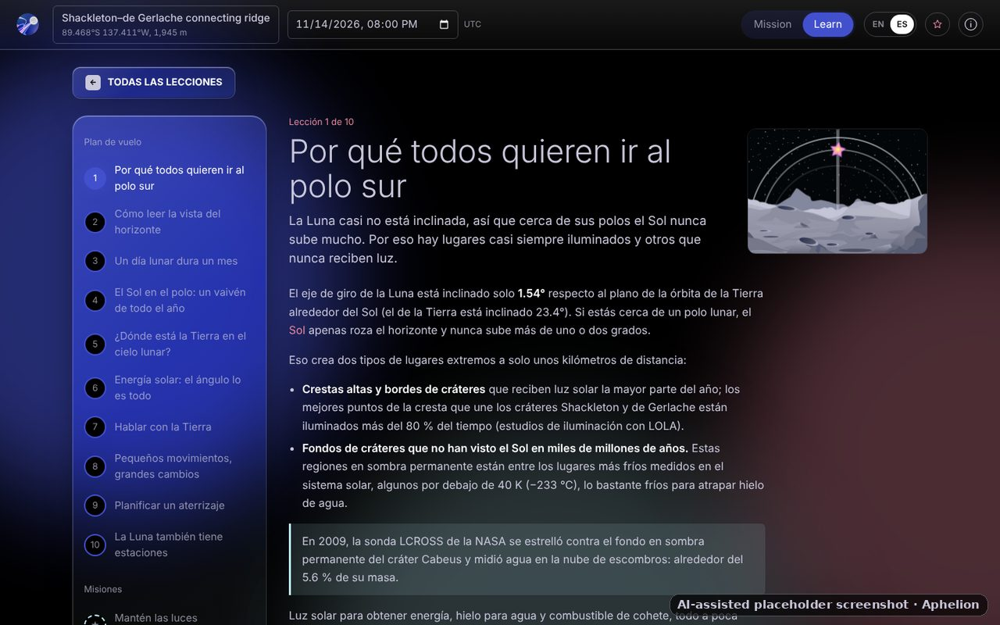<br><sub><b>En español.</b> Learn mode and the tour in Spanish, with the same science as the English version.</sub></td>
  </tr>
  <tr>
    <td colspan="2">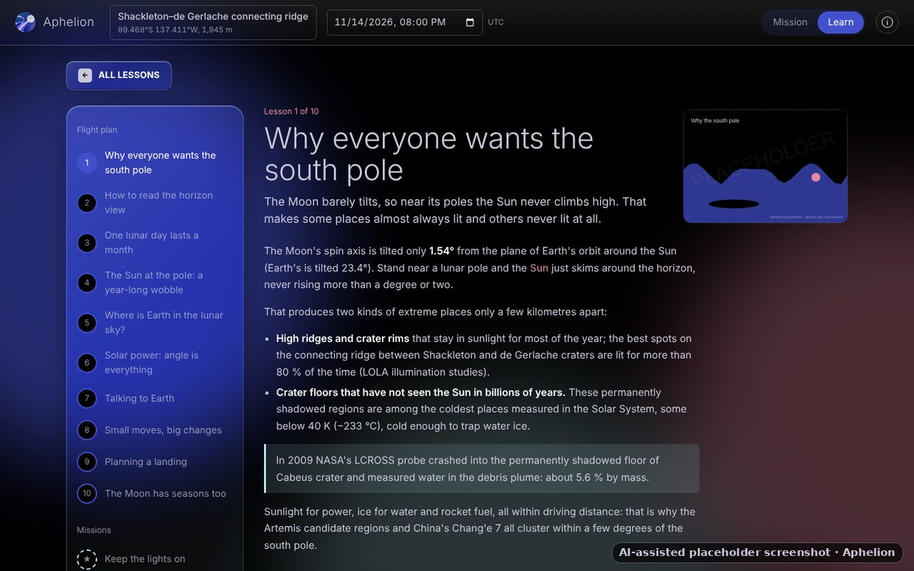<br><sub><b>Lessons with live labs.</b> Each lab runs on the same engine and terrain as Mission mode.</sub></td>
  </tr>
</table>

<p align="center"></p>

##  How it works

Everything runs **in the browser**. There is no server and no build step; GitHub Pages serves static files.

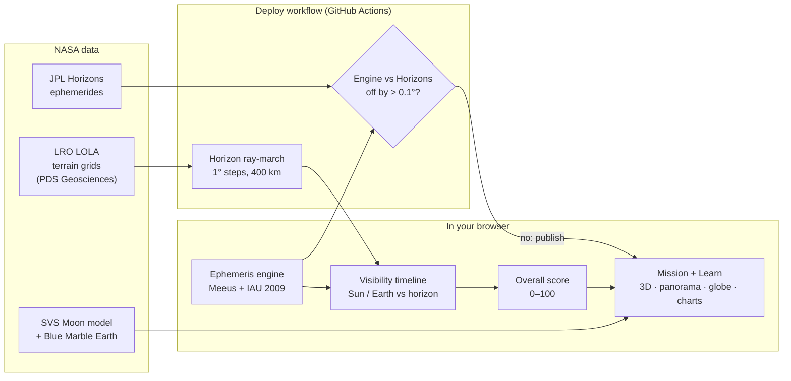

1. **Where is the Sun, where is Earth?** The engine computes both for any moment, from the Moon's surface, using Meeus' *Astronomical Algorithms* (chapters 25 and 47) and the IAU 2009 model of the Moon's orientation. Horizons blocks requests from web pages, so instead of calling it live, the deploy checks the engine against a stored Horizons table and refuses to publish if it is off by more than 0.1°.
2. **What does the horizon look like?** For every site, a ray is marched outwards from 2 m above the ground in each of 360 directions over the LOLA terrain, up to 400 km, and the highest angle it meets is the horizon in that direction.
3. **Is it visible?** The Sun or Earth counts as visible when the centre of its disc is above that terrain horizon. Doing this every few minutes over the stay gives the timeline, the percentages, the next rise or set, and the longest dark spell.
4. **What's the season?** The south pole has a mild but real season. The app uses our team report's *SAOQ* index (how far south the sub-solar point is) and shows a whole year for the site, the best landing day, and how strongly the site follows the season.

##  The overall score

One number to compare options, extending the balance score of our earlier SELENE research prototype (which used √(sunlight × Earth)):

$$
\text{score} = 100 \times P^{\,w_P}\, C^{\,w_C}\, N^{\,w_N}\, T^{\,w_T}
$$

| Factor | What it measures | Balanced weight |
|---|---|---|
| **P · Power** | share of the stay with the Sun above the terrain | 0.35 |
| **C · Comms** | share of the stay with Earth above the terrain | 0.35 |
| **N · Night survival** | 1 − (longest dark spell ÷ stay length) | 0.15 |
| **T · Terrain** | ground slope from LOLA: full marks at ≤ 5°, near zero at ≥ 20° | 0.15 |

It is a geometric mean, so a site with **no** sunlight or **no** Earth contact scores 0, however good the rest is. "Power first" and "Comms first" weightings are one click away. The weights are the team's design choice, not a NASA standard: the score is for screening and comparing, not for certifying a landing site.

<p align="center"></p>

##  NASA data

| What | NASA source | How Aphelion uses it |
|---|---|---|
| **Terrain** | LRO **LOLA** gridded data records (`LDEM_60S_240M`, `LDEM_75N_240M`, `LDEM_64`, `LDEM_16`, `LDEM_4`), PDS Geosciences Node | Terrain horizons for every site, ground height and slope, the 3D terrain patches, the globe's relief |
| **Sun and Earth positions** | **JPL Horizons** (DE440/DE441) | The reference the in-browser engine is checked against on every deploy, plus a one-click "check this in Horizons" link for any scenario |
| **Moon globe** | NASA **SVS 14959**, *Moon 3D Models for Web, AR, and Animation* (LRO imagery) | The 3D Moon in the globe view |
| **Earth** | NASA Earth Observatory **Blue Marble: Next Generation** (via NASA WorldWind) | Earth's surface in the globe view |
| **Mapping references** | NASA **Moon Trek**, ASU **LROC QuickMap** (LRO data) | Cross-checking site positions and terrain by eye |
| **Landing sites** | NASA Artemis III candidate regions, CLPS mission data, Apollo Lunar Surface Journal, LROC landing-site localisations, NASA Technical Reports Server | The 36 curated sites, each with its own citation |

Full citations, versions and processing for every item: **[DATA_SOURCES.md](DATA_SOURCES.md)**.

##  Space agency partner and other data

| Resource | Use | Licence or terms |
|---|---|---|
| JAXA (SLIM), ISRO (Chandrayaan-3), CNSA (Chang'e 3–7), Roscosmos/IKI (Luna 25) mission releases | Landing-site coordinates | Public mission releases, cited per site |
| Team report *Lunar South Pole Mission Opportunity Analysis* | SAOQ season index and the season windows the app reproduces | Team's own work |
| Team's SELENE prototype | Starting point for the 3D site scene and the balance score | Team's own work (MIT) |
| three.js r170 | 3D rendering | MIT |
| Archivo, Instrument Serif (Google Fonts) | Typefaces | SIL Open Font License |
| Bright-star list (`data/stars.json`) | Stars in the 3D sky | Carried over from SELENE; original catalogue to be confirmed |
| Published papers (De Rosa et al. 2012, Davies & Colvin 2000, Wang et al. 2024, and others) | Site positions and lesson facts | Cited in DATA_SOURCES.md |

<p align="center"></p>

##  Is it right? (validity)

We wanted no guesswork, so every claim can be checked **outside the app**:

| Check | Result |
|---|---|
| Sun and Earth positions vs **JPL Horizons** (434 samples, 7 sites, 30 days) | worst difference **0.014°**, mean **0.003°**. For scale: the Sun's disc is 0.53° wide |
| Season analysis vs the team report's Horizons DE441 values | yearly minima on the **same dates**, within **0.002°**; window ends match to the day except two, which differ by one day |
| Earth's orientation in the globe view | the point on Earth facing the Moon matches the Moon's declination and longitude from Greenwich sidereal time |
| Every deploy | fails automatically if the engine drifts more than 0.1° from Horizons |

Do it yourself, step by step, with JPL Horizons, LROC QuickMap and Moon Trek: **[VERIFY.md](VERIFY.md)**.

**Known limits, stated in the app too:** terrain is 240 m per pixel near the pole, so boulders and small craters next to a lander are not resolved; visibility uses the centre of the Sun's and Earth's discs; the overall score is a screening aid.

##  How it meets the judging criteria

Here is where you can find how Aphelion addresses each of the five NASA Space Apps judging criteria:

| Criterion | What judges look for | Where Aphelion answers it |
|---|---|---|
| **Impact** | Real-world value | Screens landing sites and dates in seconds instead of hours; Learn mode turns the same science into a free course for schools, in English and Spanish |
| **Creativity** | Originality | One engine, two audiences: a flight-console view and a game-like landing report of the *same* scenario; the season index from our own report built into a live year chart; Moon, Earth and Sun in true directions |
| **Validity** | Technical quality and feasibility | Real LOLA terrain, ephemeris checked against JPL Horizons on every deploy, every number cited, a self-check guide, no server to maintain |
| **Relevance** | Fit with the challenge and NASA's mission | Every item in the brief: curated and custom sites, side-by-side comparison, dates and seasons, time to sunset and Earthset, Sun and Earth vs the horizon, 2D and 3D views, timeline animation, beginner and expert levels. Built around Artemis south-pole regions |
| **Presentation** | Clarity and visual delivery | Clean space-grade design with intuitive color coding, beginner and expert modes, a one-minute guided tour for first-time visitors, and seamless performance on phones and desktop.|

##  Use of Super Intelligence tools

Space Apps allows SI tools if their use is disclosed. Here is ours:

- **Code and documentation.** Our team made all the planning, feature list, research, graphics, and data fetch and interpretation. These were later fed to SI models (OpenCode: DeepSeek V4.1 Flash Free & NVIDIA Nemotron 3.5 Ultra, Claude: Opus 5.5 & Fable 5.2) to help accelerate the coding process of development. A placeholder version of this README was also created by a SI model (Claude Opus 5.5) for reference purposes ONLY, the final version was written and revised by us!
- **Graphics.** Placeholder AI-generated graphics were created as needed so we could move through coding quickly. These were later replaced by our own graphics, designed by us!
- **Data.** No numbers are AI-generated. Every position, horizon and percentage is computed from the NASA data listed above, and the engine is checked against JPL Horizons.

<p align="center"></p>

##  Run and try it yourself

```bash
git clone https://github.com/starvulkan/Aphelion-Lunar-Landing-Navigator.git
cd Aphelion-Lunar-Landing-Navigator
python3 -m http.server 8000        # or: npx serve .
# open http://localhost:8000
```

**Use the web app version at:**
https://starvulkan.github.io/Aphelion-Lunar-Landing-Navigator/

First time? Press **Tour** in the top bar. Para español, elige **ES** (disponible únicamente para modo Learn).

##  Project layout

```
index.html               app shell (Mission + Learn)
css/styles.css           design system · palette #4350ce #e888a0 #bfedf8 #c9c7db #000000
js/
  app.js                 Mission mode, Professional/Educational levels, calendar, comparison, URL state
  ephemeris.js           Sun and Earth engine, visibility timeline, Earth orientation, Horizons links
  terrain.js             loads LOLA horizons, patches and tiles
  score.js               overall 0–100 score
  season.js              SAOQ season index and year-long patterns
  scene3d.js             3D terrain, Moon globe, Earth and Sun (three.js)
  viz.js                 panorama, timeline, sky dome, charts
  learn.js · lessons.js  Learn mode: lessons, labs, quizzes, missions, XP, badges
  lessons.es.js          Learn mode content in Spanish
  i18n.js                English/Spanish interface text for Learn mode and the tour
  tour.js                guided tour of the app
  sites.js               36 curated sites, each with a source
  store.js               saves progress in the browser
tools/
  build-data.mjs         rebuilds data/ from NASA sources
  lola-horizon.js        horizon ray-marcher (shared by app and build)
  validate.mjs           engine vs JPL Horizons
  validate-season.mjs    season analysis vs the team report
  horizons-fetch.mjs     refreshes the Horizons reference table
  make-web-moon.py       web-sized copies of NASA's Moon model
  stamp-version.mjs      cache-busting version stamps
data/                    horizons, terrain patches, tiles, Horizons reference, stars
graphics/                logo, icon, models, textures (see graphics/README.md)
vendor/three/            three.js r170
```

##  Team

**Aphelion Labs** · NASA Space Apps Challenge 2026 · Tegucigalpa, Honduras

| Name | Role |
|---|---|
| _Alirio Henrriquez_ | _Investigator and Data Fetch_ |
| _Andrea Zedan_ | _Investigator and Revision_ |
| _Edward Martínez_ | _Coder_ |
| _Romina Camas_ | _Graphic Designer_ |

##  Credits and licence

Code: **Apache License 2.0** (see [LICENSE](LICENSE)). Third-party data and libraries keep their own terms, listed in [DATA_SOURCES.md](DATA_SOURCES.md).

The Moon model is credited to **NASA's Goddard Space Flight Center** (SVS 14959). The Earth image is **NASA Blue Marble: Next Generation**, by Reto Stöckli, NASA Earth Observatory. Terrain is from the **LRO LOLA** team via the PDS Geosciences Node. Sun and Earth reference positions come from **NASA/JPL Horizons**. This project is not endorsed by NASA and uses no NASA logos or insignia.

**About the SELENE research prototype:** SELENE was a demo app made for research and practice purposes, as to get familiar with what we would be doing and programming during the event. As to comply with competition rules, NO parts of the codebase for Aphelion LLN use direct code from SELENE, as it was created before the event. SELENE was created for research and feature testing purposes only.

<br>

<p align="center"></p>
<p align="center"><sub>Made with love in Honduras!</sub></p>
